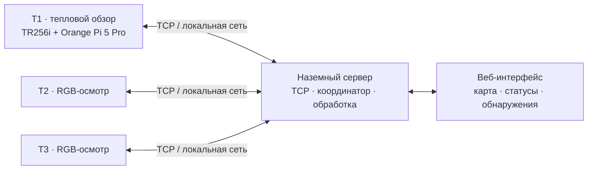

# HiTechROY / ThermoSwarm

**Программно-аппаратный комплекс группового управления беспилотными авиационными системами для выявления тепловых аномалий и повторного осмотра объектов.**

**Хайтек 2026** · Компетенция «Летающая робототехника» · **Кейс 3: «Роевое управление — защита сельскохозяйственных угодий и плантаций от насекомых-вредителей»**

**Материалы для экспертов:** [Экономика роя — расчётная таблица (Excel)](https://github.com/isankhx/HiTechROY/blob/main/docs/modules/module%20C/%D0%AD%D0%BA%D0%BE%D0%BD%D0%BE%D0%BC%D0%B8%D0%BA%D0%B0_%D1%80%D0%BE%D1%8F_%D0%91%D0%9F%D0%9B%D0%90.xlsx) · [Экономика роя — документ (Word)](https://github.com/isankhx/HiTechROY/blob/main/docs/modules/module%20C/%D0%AD%D0%BA%D0%BE%D0%BD%D0%BE%D0%BC%D0%B8%D0%BA%D0%B0_%D1%80%D0%BE%D1%8F_%D0%91%D0%9F%D0%9B%D0%90.docx) · [Папка модуля C](https://github.com/isankhx/HiTechROY/tree/main/docs/modules/module%20C)

## 1. Назначение проекта

ThermoSwarm координирует работу трёх БАС в помещении с локальной системой позиционирования. Первый аппарат обследует участок с тепловизором. При обнаружении температурной аномалии наземный координатор рассчитывает её положение и направляет свободный ведомый аппарат на повторную RGB-съёмку. Положение БАС, ход миссии, обнаружения и сообщения системы отображаются в веб-интерфейсе оператора.

**Тепловая аномалия не равнозначна подтверждённому заражению растения.** Система предназначена для обнаружения подозрительных объектов и организации дополнительного осмотра.

### Конфигурация комплекса

| Обозначение | Платформа | Назначение |
|---|---|---|
| **T1** | SKYRIS «Техник 6S», Orange Pi 5 Pro, тепловизор **TR256i** | Первичное тепловое обследование, формирование кандидатов на повторный осмотр |
| **T2** | SKYRIS «Техник 6S», RGB-камера | Повторная съёмка обнаруженного участка |
| **T3** | SKYRIS «Техник 6S», RGB-камера | Повторная съёмка и резервирование T2 |
| **Наземный узел** | Компьютер в локальной сети | Координация миссии, анализ поступивших данных, веб-интерфейс, журналы |

Для навигации на демонстрационной площадке применяется **ArUco**, а обмен между бортовыми агентами и наземным сервером осуществляется через **TCP по локальной IP-сети**. Использование GNSS в помещении не предполагается.

## 2. Архитектура



Координация заданий **централизованная**: T1 сообщает об обнаружении, сервер назначает повторный осмотр T2 или T3. Прямой канал управления T1 → T2/T3 в предоставленной реализации не используется.

Общая последовательность работы:

1. Бортовые агенты подключаются к серверу, передают телеметрию и данные датчиков.
2. Оператор запускает миссию через веб-интерфейс.
3. T1 следует по маршруту первичного обследования.
4. Модуль анализа тепловых кадров выделяет температурные аномалии и связывает их с координатами площадки.
5. Координатор передаёт задачу доступному T2/T3; ведомый перемещается к цели и выполняет RGB-съёмку.
6. При наличии весов RGB-модели YOLO снимок дополнительно обрабатывается детектором.
7. События, координаты, фотографии и телеметрия сохраняются для анализа и составления протоколов.

### Основные программные компоненты

| Файл | Назначение |
|---|---|
| `thermoswarm/run_server.py` | Запуск сервера, режима симуляции и веб-приложения |
| `thermoswarm/server/hub.py` | TCP-подключения бортов, приём сообщений и команды |
| `thermoswarm/server/mission.py` | Состояния миссии, маршруты, назначение осмотра и возврат |
| `thermoswarm/server/traffic.py` | Проверка пересечения маршрутов и логика разведения |
| `thermoswarm/server/thermal.py` | Обработка тепловых кадров и выделение аномалий |
| `thermoswarm/server/vision.py` | Обработка RGB-снимков (YOLO или SIM-детектор) |
| `thermoswarm/board/agent.py` | Бортовой агент, связь с ROS и наземным сервером |
| `thermoswarm/board/thermal_drivers.py` | Предусмотренные интерфейсы получения тепловых кадров |
| `thermoswarm/web/` | Интерфейс оператора |
| `thermoswarm/tests/` | Тесты интеграции и отказов |

> **Важно о версиях:** таблица отражает структуру предоставленного исходного архива `thermoswarm.zip`. Новые файлы и функции из последующей редакции технической документации необходимо добавить в репозиторий и проверить отдельно, прежде чем ссылаться на них как на реализованные.

## 3. Используемые технологии

- **Python 3.10+** — наземный сервер и симуляция;
- **FastAPI, Uvicorn** — HTTP API и веб-интерфейс;
- **TCP** — обмен между сервером и бортовыми агентами (JSON-заголовок и при необходимости бинарная нагрузка);
- **ROS 1 / PX4** — интерфейс управления БАС в варианте бортового агента из предоставленного кода;
- **ArUco** — позиционирование в локальной системе координат;
- **NumPy, Pillow** — обработка данных;
- **Ultralytics YOLO (опционально)** — распознавание объектов на RGB-фотографиях;
- **TR256i** — выбранный тепловизор ведущего аппарата T1.

### TR256i и Orange Pi 5 Pro

Тепловизор **TR256i** планируется подключать **непосредственно** к Orange Pi 5 Pro: USB-C со стороны тепловизора → USB-порт данных Orange Pi (при необходимости через кабель/переходник USB-C → USB-A с поддержкой передачи данных). Питание Orange Pi подаётся отдельно.

Подключение к USB **не означает автоматической совместимости**. Перед натурной эксплуатацией необходимо проверить обнаружение устройства в Linux, получение кадров, формат пикселей, возможность считывания температурных значений и согласование поля зрения с настройками координатной привязки. Наличие готового драйвера именно для TR256i в предоставленном архиве **не подтверждено**.

## 4. Структура исходного кода

```text
HiTechROY/
├── README.md                        # этот файл, корень репозитория
└── thermoswarm/                     # программный комплекс (добавить из архива исходников)
    ├── run_server.py
    ├── requirements.txt
    ├── config.json
    ├── aruco_map.txt
    ├── board/
    │   ├── agent.py
    │   ├── agent.example.json
    │   ├── protocol.py
    │   └── thermal_drivers.py
    ├── server/
    ├── web/
    ├── models/
    ├── tools/
    ├── tests/
    └── docs/
        ├── ARCHITECTURE.md
        ├── CONFIG.md
        ├── PROTOCOL_API.md
        └── FAILURES.md
```

**Внимание:** на момент сверки корневой README доступен в GitHub, но каталог `thermoswarm/` в текущей ветке репозитория не найден. Для работы приведённых ниже команд необходимо сначала разместить исходники комплекса в этом каталоге. Не следует считать структуру выше уже опубликованной целиком.

## 5. Быстрый запуск симуляции

Симуляция позволяет изучить цикл миссии **без подключения физических БАС**.

Требования: Python 3.10+, установленный исходный каталог `thermoswarm/`.

```bash
# Из корня репозитория
cd thermoswarm
python -m venv .venv
```

**Windows (PowerShell):**

```powershell
.venv\Scripts\Activate.ps1
python -m pip install -r requirements.txt
python run_server.py --sim
```

**Linux:**

```bash
source .venv/bin/activate
python -m pip install -r requirements.txt
python run_server.py --sim
```

Открыть веб-интерфейс: **http://127.0.0.1:8080**. Для ускоренного воспроизведения симуляции используется `python run_server.py --sim --speed 3`.

В симуляции при отсутствии весов YOLO используется **упрощённый цветовой SIM-детектор**. Он не является нейросетевой детекцией.

## 6. Запуск сервера с реальными бортовыми агентами

Только после проверки бортового ПО, безопасности и совместимости оборудования:

```bash
cd thermoswarm
python run_server.py
```

По конфигурации предоставленного кода:

- **TCP 7700** — подключения бортовых агентов;
- **HTTP 8080** — панель оператора;
- сервер и три Orange Pi находятся в одной локальной сети.

Для доступа к панели с другого устройства в локальной сети:

```bash
python run_server.py --http-host 0.0.0.0
```

Конфигурация каждого борта создаётся из `thermoswarm/board/agent.example.json`: установить уникальный `id` (`T1`, `T2`, `T3`), IP сервера, параметры ROS-топиков и источник тепловых кадров для T1.

На Orange Pi, **без вооружения БАС и со снятыми пропеллерами**, предусмотрена самопроверка:

```bash
cd ~/thermoswarm
cp agent.example.json agent.json
# Указать свой ID, IP сервера и параметры датчиков в agent.json
source ~/technic_ws/devel/setup.bash  # если именно такой путь используется на вашем образе
python3 agent.py --check
```

Проверка теплового источника выполняется отдельно: `python3 agent.py --probe-thermal`. Конкретный драйвер TR256i перед использованием необходимо подобрать и проверить по результатам диагностики.

Команды управления БАС нельзя отправлять одновременно из ThermoSwarm и другого управляющего приложения. Реальные полёты проводятся только на подготовленной площадке с оператором, проверенными аварийными режимами и утверждёнными условиями испытания.

## 7. Тестирование

Следующие команды предусмотрены в архиве исходников и проверяют **программные сценарии**, а не подтверждают натурные характеристики аппаратов:

```bash
cd thermoswarm
python tests/test_real_mode.py
python tests/test_faults.py link
# Полный набор сценариев отказов:
python tests/test_faults.py
```

`test_real_mode.py` запускает реальные классы сервера и агентов с **подменой ROS** (`FakeRos`). `test_faults.py` проверяет сценарии отказа в моделируемой среде. Их результаты нельзя использовать вместо полётных журналов.

Для фиксации результатов натурных проверок применяются отдельные протоколы T1–T7 с датой, составом оборудования, версиями ПО, измерениями, PASS/FAIL, фото, видео и логами.

### Результаты и журналы

После запуска программного комплекса данные миссии сохраняются в `thermoswarm/runs/<дата-время>/`:

- `events.jsonl` — события и сообщения системы;
- `telemetry.jsonl` — телеметрия аппаратов;
- `thermal.f32` и `thermal.jsonl` — тепловые данные и индекс кадров;
- `photos/` и `anomalies.json` — снимки и обнаружения (при наличии данных).

## 8. Текущий статус и ограничения

| Подсистема | Статус по предоставленному исходному коду |
|---|---|
| Сервер, TCP-протокол, веб-интерфейс | Реализованы программно |
| Алгоритм миссии трёх агентов и предотвращения конфликтов | Реализован; предусмотрены симуляционные проверки |
| Тепловые аномалии | Реализован пороговый алгоритм, **не нейросетевой ИК-детектор** |
| Повторный RGB-осмотр | Предусмотрены назначение цели и съёмка; полноценный облёт с нескольких ракурсов требует проверки по актуальной версии кода |
| RGB YOLO | Поддерживается при наличии совместимых весов `models/rgb.pt` |
| TR256i → Orange Pi 5 Pro | Физическая и программная совместимость требует подтверждения |
| Нейросетевая детекция на ИК-кадрах, `mAP@0.5 ≥ 0,85` | Не подтверждена предоставленным архивом |
| Натурные характеристики трёх БАС | Подтверждаются **отдельными** протоколами испытаний, не этим README |

Параметры безопасной дистанции в `config.json` являются **настройками алгоритма**, а не измеренным фактическим зазором. При испытаниях отдельно учитываются габариты аппаратов, погрешность позиционирования и задержки управления.

## 9. Документация проекта

После публикации каталога `thermoswarm/` в репозитории доступны:

- [`docs/ARCHITECTURE.md`](thermoswarm/docs/ARCHITECTURE.md) — описание архитектуры;
- [`docs/PROTOCOL_API.md`](thermoswarm/docs/PROTOCOL_API.md) — форматы TCP-сообщений, HTTP API и журналов;
- [`docs/CONFIG.md`](thermoswarm/docs/CONFIG.md) — конфигурация сервера и бортовых агентов;
- [`docs/FAILURES.md`](thermoswarm/docs/FAILURES.md) — обработка отказов;
- [`tests/`](thermoswarm/tests/) — программные тесты.

Полная техническая документация и подписанные протоколы испытаний оформляются отдельно. Ссылки на их опубликованные версии следует добавить после размещения файлов в репозитории.

## 10. Экономика роя — документы для экспертной проверки

Экономические материалы проекта опубликованы в репозитории в каталоге [`docs/modules/module C/`](https://github.com/isankhx/HiTechROY/tree/main/docs/modules/module%20C). Их можно открыть прямо из README, не разыскивая файлы в структуре GitHub.

| Документ | Ссылка | Для чего открыть |
|---|---|---|
| **Экономика роя БПЛА — Excel** | **[Открыть расчётную таблицу (.xlsx)](https://github.com/isankhx/HiTechROY/blob/main/docs/modules/module%20C/%D0%AD%D0%BA%D0%BE%D0%BD%D0%BE%D0%BC%D0%B8%D0%BA%D0%B0_%D1%80%D0%BE%D1%8F_%D0%91%D0%9F%D0%9B%D0%90.xlsx)** | Проверить экономические данные и расчётную таблицу проекта |
| **Экономика роя БПЛА — Word** | **[Открыть экономическую документацию (.docx)](https://github.com/isankhx/HiTechROY/blob/main/docs/modules/module%20C/%D0%AD%D0%BA%D0%BE%D0%BD%D0%BE%D0%BC%D0%B8%D0%BA%D0%B0_%D1%80%D0%BE%D1%8F_%D0%91%D0%9F%D0%9B%D0%90.docx)** | Ознакомиться с текстовым экономическим обоснованием проекта |

**Порядок ознакомления для экспертов:**

1. Откройте **документ Word** для общего описания экономической части.
2. Откройте **таблицу Excel**, чтобы рассмотреть исходные показатели, расчёты и допущения, представленные командой.
3. При проверке числовых выводов используйте актуальные значения из приложенных файлов. Не следует считать проектные допущения подтверждённой фактической экономией без соответствующих исходных данных.
4. Если GitHub не показывает предпросмотр `.docx` или `.xlsx`, откройте страницу файла и нажмите **Download raw file** (значок скачивания), затем откройте файл в Word или Excel.

**Расположение в репозитории:** `HiTechROY → docs → modules → module C → Экономика_роя_БПЛА.docx / Экономика_роя_БПЛА.xlsx`.

## 11. Команда

| Участник | Направление работы |
|---|---|
| Гращенков Иван | Инженерная интеграция и разработка ПО |
| Жигулев Даниил | Инженерная часть и техническая документация |
| Егорова Кристина | Сетевое взаимодействие и программирование |
| Осадчий Павел | Программирование и сетевое взаимодействие |
| Вонсович Илья | Техническая документация и подготовка материалов проекта |

## 12. Лицензирование

Условия использования кода определяются файлом `LICENSE` **после его добавления и утверждения командой**. Отсутствие такого файла нельзя заменять декларацией о лицензии в README.

---

*ThermoSwarm / HiTechROY · Хайтек 2026 · Кейс 3.*
